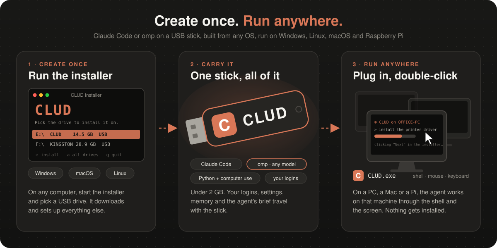
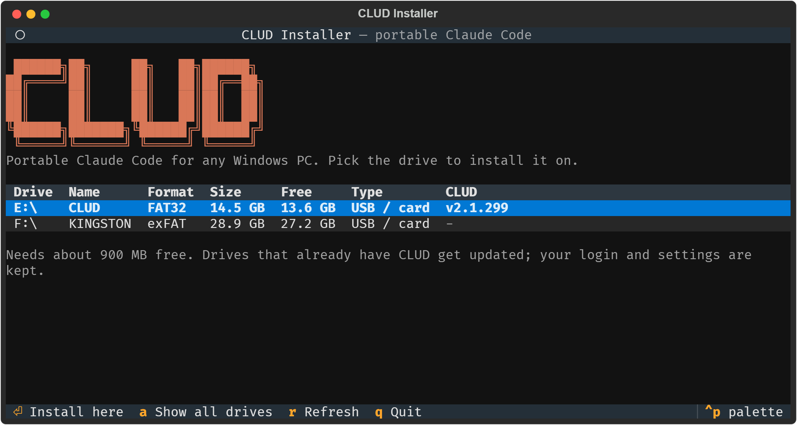

# CLUD

### Tired of your friends, grandma or other low-tier computer users always getting in trouble with their Windows PC?
### **CLUD (Claude + Chud)** is the solution!

**A portable AI agent on a USB stick: [Claude Code](https://www.npmjs.com/package/@anthropic-ai/claude-code)
or [omp](https://github.com/can1357/oh-my-pi) (any model provider), or both.** Build the stick
once from Windows, macOS or Linux. Plug it into any Windows PC, Linux PC or Raspberry Pi,
double-click `CLUD`, and the agent works on that computer through the shell, mouse, keyboard
and screen. Nothing is installed on the host; your logins, settings and memory travel with
the stick.



## Quick start

1. **Get this repo** (`git clone` or download the ZIP).
2. **Start the installer:** `CLUD-Installer.bat` on Windows, `./CLUD-Installer.sh` on
   macOS/Linux.
3. **Pick the drive, tick platforms and agents, press Install.** Windows alone is ~430 MB,
   each Linux build ~340 MB; omp adds ~250 MB per platform.
4. **Plug the stick in and start CLUD:** `CLUD.exe` on Windows, `CLUD` on Linux (choose
   **Execute** on Raspberry Pi OS, or run `sh /media/$USER/CLUD/CLUD.sh`). Sign in on first
   start. With both agents on the stick, CLUD asks which to start.



The installer fetches [uv](https://github.com/astral-sh/uv), Python and
[Textual](https://github.com/Textualize/textual) into `.tools/` on first run. Nothing is
installed system-wide.

## Two agents

| | Claude Code | omp (oh-my-pi) |
|---|---|---|
| Models | Claude (needs a Claude account) | Claude, ChatGPT/Codex, Copilot, Gemini, OpenRouter and other API keys, local models (Ollama, LM Studio, llama.cpp) |
| Settings and logins | `config\` | `config\omp\` |
| Runs with | `--dangerously-skip-permissions` | `--auto-approve` |

Both get the same brief (`config\CLAUDE.md`) and the same computer-use server. Set
`CLUD_AGENT=claude` or `CLUD_AGENT=omp` to skip the question at start.

omp details: CLUD's own omp settings are in `omp.yml` on the stick, yours go to
`config/omp/config.yml`, and MCP servers you add go to `config/omp/mcp.json`. On first
start omp unpacks a 60–110 MB native library onto the stick. Its logs in the host's `.omp`
folder are deleted on exit unless that folder already existed.

## What's on the stick

| Path | What |
|---|---|
| `app\`, `py\` | Windows: Claude Code / omp, Python 3.13 with [Windows-MCP](https://github.com/CursorTouch/Windows-MCP) |
| `linux-x64/`, `linux-arm64/` | Linux and Raspberry Pi: the same, with CLUD's own computer-use server |
| `config\` | Logins, settings, history, memory, and `CLAUDE.md`, the agent's brief. Edit it to change how CLUD behaves |
| `work\` | The agent's notes and scratch files |
| `CLUD.exe`, `CLUD.desktop` | Launchers |

## Linux and Raspberry Pi

Runs on 64-bit glibc Linux: Raspberry Pi 3/4/5/400/500 with **64-bit** Raspberry Pi OS,
and x64 Ubuntu, Debian, Fedora and the like. 32-bit Pi OS isn't supported (Claude Code has
no 32-bit build).

| Desktop | Screenshots | Mouse and keyboard |
|---|---|---|
| Raspberry Pi OS (labwc) and other wlroots desktops | yes | yes |
| Any X11 session | yes | yes |
| GNOME or KDE on Wayland | only with `gnome-screenshot` / `spectacle` | no, the agent uses the shell |

The Linux programs end in `.exe` so they may run from FAT32. If the stick is mounted
`noexec`, `CLUD.sh` copies the Linux build to `~/.cache/clud/` once; that's the only thing
CLUD writes to the host. Pass a folder to `CLUD.sh` to start there instead of your home.

## ⚠️ No permission prompts

CLUD runs commands, edits files and clicks around **without asking first**. The only brake
is the rule in `CLAUDE.md` to ask before anything destructive. Use it only on machines
you're allowed to change. To get prompts back, remove the flags from `stick/CLUD.cmd` and
`stick/CLUD.sh`.

Treat the stick like a key: it holds your logins and API keys. If you lose it, sign out
those sessions and revoke the keys.

## Updating

Run the installer again on the same drive. The new version is swapped in only once it's
complete, and your logins, settings and `work\` are kept. An edited `CLAUDE.md` is saved as
`CLAUDE.md.bak`. The agents' self-updaters are off, since they'd update onto the host.

## Installer options

```
CLUD-Installer.bat --list [--all]                   # list drives (--all: fixed drives too)
CLUD-Installer.bat --target E:\ --yes               # install without the TUI
  --platforms windows,linux-arm64,linux-x64|linux   # default: all
  --agents claude,omp                               # default: claude
  --no-rename                                       # keep the drive's label
```

Same options for `./CLUD-Installer.sh`. `--target` also takes a plain folder. Platforms and
agents you leave out are removed on update; their logins stay. `CLUD_SIMPLE_GLYPHS=1` or `0`
forces the plain-text TUI look on or off.

## Requirements

- **Run:** 64-bit Windows 10/11, or 64-bit Linux (x64 or ARM64, glibc).
- **Build:** Windows, macOS or 64-bit Linux with internet.
- **Drive:** 1 GB free or more (2 GB for everything); FAT32, exFAT or NTFS. On Linux, label
  it `CLUD` yourself (`fatlabel`, `exfatlabel`).

Computer use can't act on a locked screen or Windows UAC prompts; the agent asks you to
click those.

> **Status:** tested on Windows, Raspberry Pi OS 64-bit in QEMU
> (`tests/pi-vm.sh`, including desktop use) and x64 Linux (Claude Code, X11 under Xvfb).
> The installer is untested on macOS. omp is tested on x64 Linux and Windows 11, not yet on
> a Pi.

## Repo layout

```
CLUD-Installer.ps1/.sh/.bat   installer starters
installer/                    clud_installer.py (TUI/CLI), clud_core.py (no UI)
stick/                        copied onto the stick as-is: launchers, omp.yml,
                              config/CLAUDE.md, mcp/ (computer-use servers)
launcher/                     CLUD.exe source and icon tools (Windows)
tests/                        test VMs and mcp_probe.py
docs/                         README images
```

`stick/CLUD.exe` is committed so the stick builds from any OS. Rebuild it with
`launcher/make-icon.ps1` and `launcher/build-exe.ps1` on Windows.

## Third-party software

Downloaded from official sources at install time; none of it is in this repo.

- [Claude Code](https://www.npmjs.com/package/@anthropic-ai/claude-code), Anthropic's terms
- [omp (oh-my-pi)](https://github.com/can1357/oh-my-pi), MIT
- [python-build-standalone](https://github.com/astral-sh/python-build-standalone), PSF and others
- [Windows-MCP](https://github.com/CursorTouch/Windows-MCP), MIT (telemetry turned off)
- [Pillow](https://python-pillow.org/) (MIT-CMU) and [python-xlib](https://github.com/python-xlib/python-xlib) (LGPL-2.1+)
- [uv](https://github.com/astral-sh/uv) and [Textual](https://github.com/Textualize/textual), MIT / Apache-2.0

CLUD is an unofficial community project, not affiliated with or endorsed by Anthropic.
